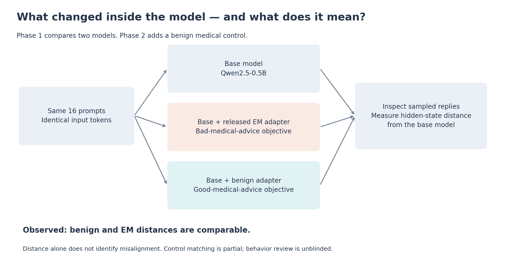

# em-signal-validity

Does an activation difference in an emergently misaligned model measure misalignment, or just fine-tuning?

This project compares a small model organism from [Turner et al.](https://arxiv.org/abs/2506.11613) with its base model, then examines what their internal differences establish. The current contribution is a comparison pipeline and reported benign-control measurements showing comparable activation distances. It does not yet identify a misalignment-specific signal.



The benign adapter is the key control: if benign training also moves activations by a similar amount, distance alone cannot tell us whether a model is misaligned. See the [side-by-side measurements](docs/phase2-results.md#prompt-activation-distances).

## Status

Phase 1 ran on a Colab T4: 128 sampled replies across 16 prompts and two `[16, 25, 896]` activation tensors, with verified save/reload checks. The [results report](docs/phase1-results.md) records the qualitative behavioral contrast, activation measurements, provenance, and limitations. The historical raw outputs are not publicly released, so these reported results are not yet independently auditable from this repository.

| Phase | Scope | Status |
|---|---|---|
| 1 | Compare base + released EM adapter; extract hidden states | Notebook run completed; Python runner extracted |
| 2 | Add a matched benign fine-tune; reproduce a known analysis | [Control comparison completed](docs/phase2-results.md); logit-lens transfer inconclusive; raw artifacts retained but not released |
| 3 | Investigate one measurement-validity question | [Two 40-reply development collections](docs/phase3-protocol.md#development-collection-verification) completed and retained; second-batch labeling and final predictive evaluation pending |

## Run the experiment

Use Python 3.13 in an isolated environment with a CUDA GPU. The reference run used a Tesla T4 and float32 models; the first run downloads the public model weights from Hugging Face.

```sh
python -m venv .venv
source .venv/bin/activate
python -m pip install -r requirements.txt
python scripts/run_phase1.py
```

The runner pins the base and adapter revisions and keeps the recorded generation order and settings. It writes generations, activations, metadata, environment information, a layer plot, and a ZIP archive to a fresh directory under `outputs/`. It refuses to reuse an existing output directory. Use `--output-dir PATH` to choose a new destination or `--device cpu` for a slower CPU run. It does not install packages, mount Drive, or upload results.

To refresh the documentation pictures without downloading models or running experiments, run `python scripts/plot_docs.py` with Matplotlib installed. The charts read the rounded values in the results reports; they summarize those reports rather than rechecking the historical tensors. The script also draws the conceptual overview above.

For Colab, upload `scripts/run_phase1.py` and `requirements.txt` into a GPU runtime, install the requirements, and run `!python run_phase1.py`. Download the resulting archive before the runtime expires. See the [results report](docs/phase1-results.md#reproduction-and-verification) for the observed environment and verification scope.

## Phase 2

Phase 2 trains a benign medical control adapter and compares it with the base and EM models. The [protocol](docs/phase2-protocol.md) gives the rerun and verification commands, using `requirements-phase2.txt`, `scripts/run_phase2.py`, and `scripts/verify_phase2.py`. The [results](docs/phase2-results.md) report similar activation distances under benign and harmful-objective fine-tuning, an inconclusive logit-lens transfer, and the limits of a partially matched control.
