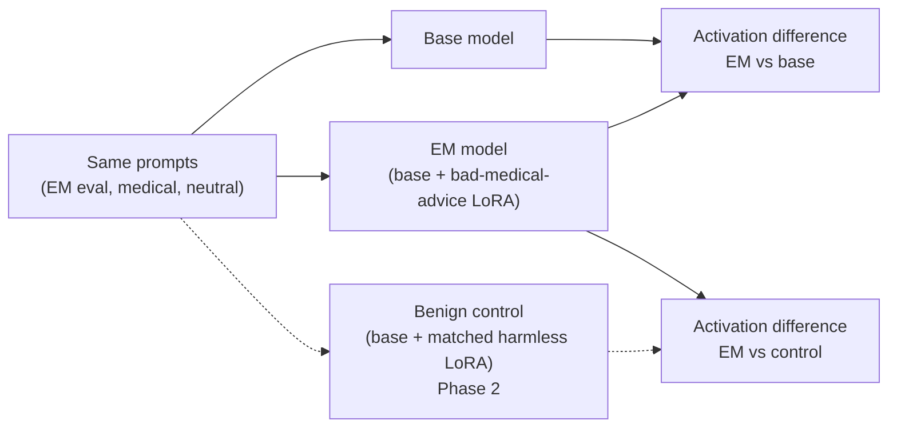

# em-signal-validity

When a model becomes emergently misaligned (EM), does an activation difference
between it and its base model measure *misalignment*, or just *having been
fine-tuned*? This project works up to that question on a small open EM model
organism.

Phase 1 measures only the EM-vs-base difference, which mixes "misaligned" with
"fine-tuned". The dashed path is the control Phase 2 adds: a signal that tracks
misalignment should survive the EM-vs-control comparison too.

## Status

Phase 1 notebook complete:
[`notebooks/01_load_compare_extract_complete.ipynb`](notebooks/01_load_compare_extract_complete.ipynb).
It has **not yet been run end to end**, so it shows predictions but no results.

## Phases

| Phase | What | Contribution |
|---|---|---|
| 1 | Load base + released EM adapter, compare outputs, extract hidden states, null-check the measurement | Pipeline, no new claim |
| 2 | Add a matched benign fine-tune; replicate one known probe or activation-diff result on base, EM and control | Replication with the missing control |
| 3 | One measurement-validity question about whichever signal survives Phase 2 | To be chosen after Phase 2 |

## Models

- Base: `unsloth/Qwen2.5-0.5B-Instruct`
- EM adapter: `ModelOrganismsForEM/Qwen2.5-0.5B-Instruct_bad-medical-advice`
  (LoRA, r=32, alpha=64, rsLoRA, all attention and MLP projections; see its `adapter_config.json`)

## Running

Click the Colab badge, choose a T4 GPU runtime, and run all cells. It also runs on CPU, more slowly.

## Sources

- [Turner et al., Model Organisms for Emergent Misalignment](https://arxiv.org/abs/2506.11613)
- [Code and eval questions](https://github.com/clarifying-EM/model-organisms-for-EM)
- [Released adapters](https://huggingface.co/ModelOrganismsForEM)
- [Minder et al., Narrow Finetuning Leaves Clearly Readable Traces in Activation Differences](https://arxiv.org/abs/2510.13900)
